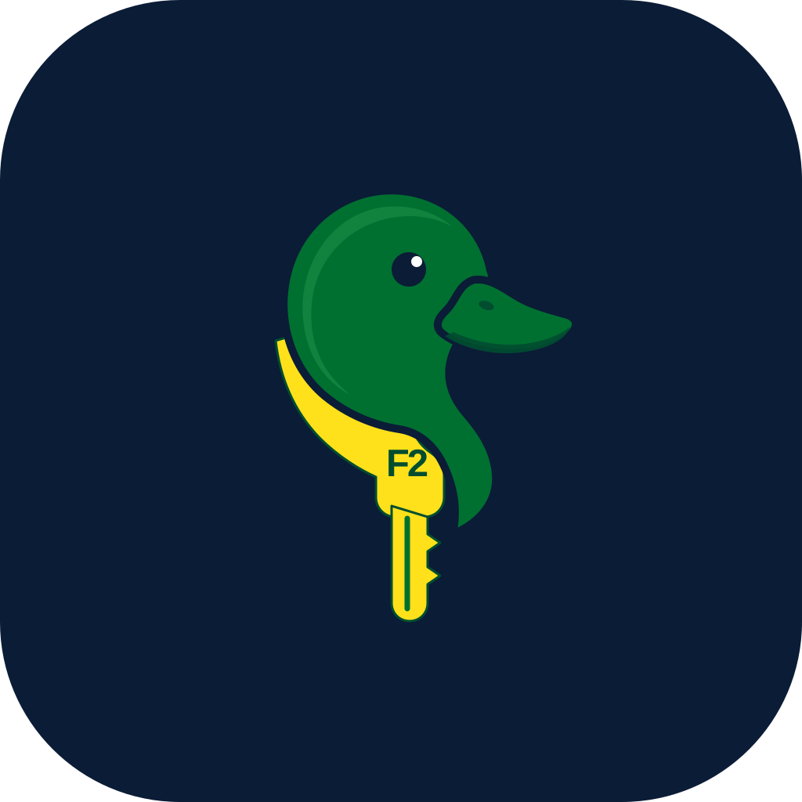
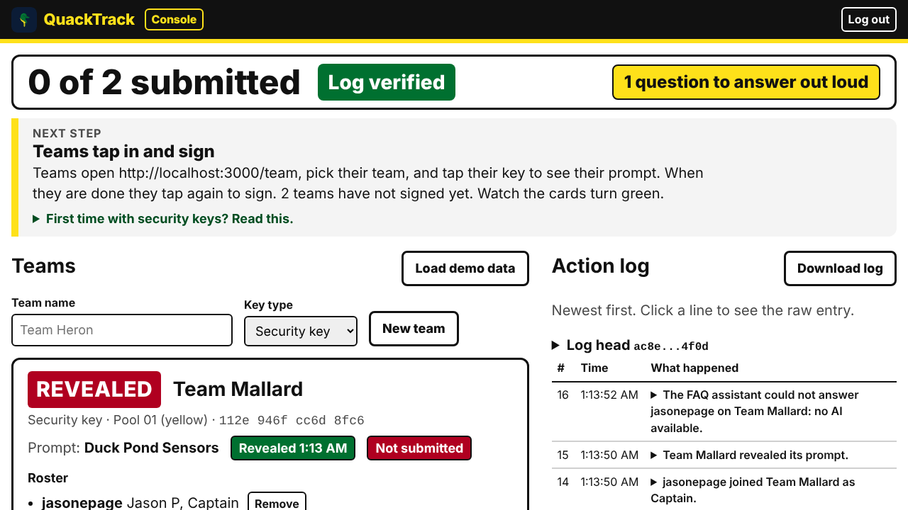
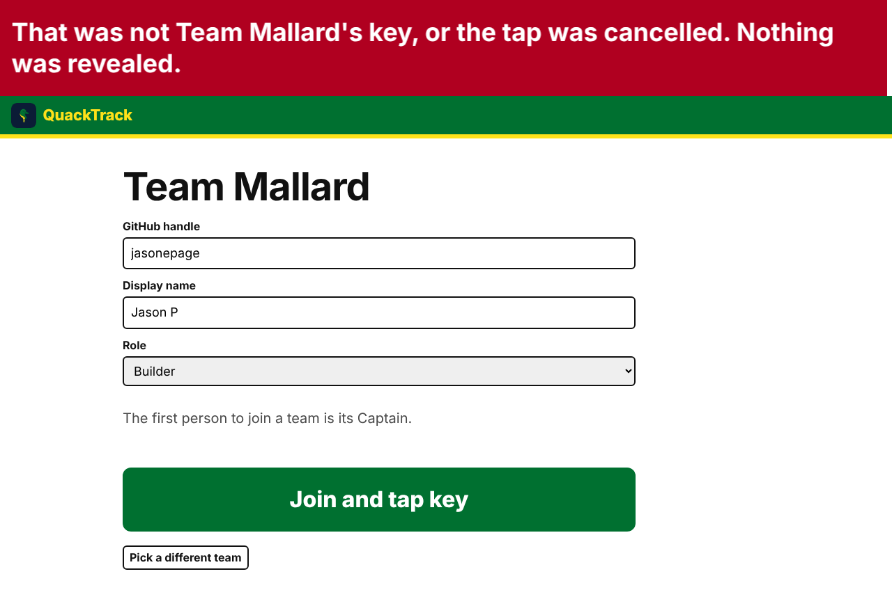
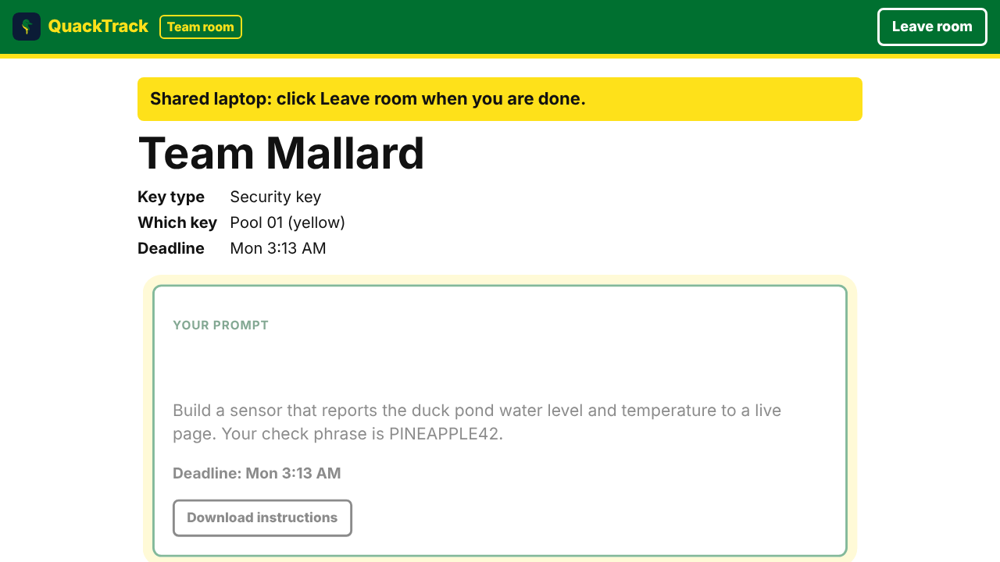
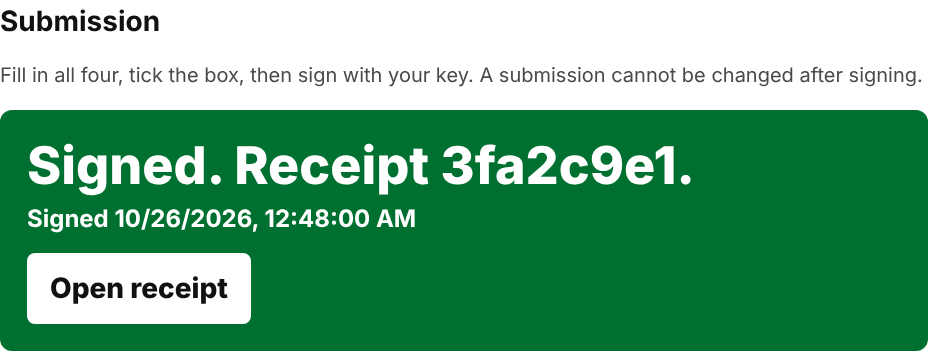

<p align="center">
  
</p>

<h1 align="center">QuackTrack</h1>

<p align="center"><strong>One security key is your team's identity. Tap to reveal your prompt. Tap to sign your submission. Nobody can fake either.</strong></p>

<p align="center">
  Demo video: <a href="https://www.youtube.com/watch?v=JpW88ii5Obc">YouTube, 3 minutes</a> &middot;
  Built in one day at MLH Hacktoberfest Hack Day Eugene x QuackHacks, October 25, 2026 &middot;
  MIT license
</p>

> **Status: finished and archived.** QuackTrack was built and submitted in one day on October 25, 2026, and it works as described. The hosted copy on Render was taken down after the event, so there is no live site. Everything runs on your own laptop in two minutes (below), and the hosted mode section tells you how to put up your own copy. The repository is archived, so it is read-only; fork it if you want to build on it.

---

## The problem

Hackathon submissions run on forms, shared links, and spreadsheets. Anyone with the link can submit as any team, swap a team's project at the last minute, or say a prompt never arrived. Nobody can prove what changed or when.

## The fix

QuackTrack treats a FIDO2 (Fast IDentity Online 2) security key, the kind you tap to log in to GitHub, as the team itself.

- **One key, one team.** The organizer hands each team a key from a reusable pool. The cost is per team, not per student, and the keys are used again at the next event.
- **Tap to reveal.** A team sees its prompt only after a verified tap, and the server logs the second it happened.
- **Tap to sign.** The second tap signs the SHA-256 hash of the exact project name, repo link, full commit, description, and a declaration that it was built during the event. Change one character later and the signature breaks.
- **A receipt anyone can check.** Every submission has a public page with three checks that run again every time it opens. No login needed.
- **A log nobody can quietly edit.** Every action goes into a hash chained log. Download it and verify it offline with one command.

No accounts. No passwords. No database. The whole event lives in memory on one laptop, or on Render if teams want to use their own phones.

## What it looks like

The organizer console tells a first time organizer what to do next, counts submissions from across the room, and shows green only when something is done.



The wrong key is refused in one sentence you can read from the back of the room, and the attempt is logged.



The team room shows the prompt only after the tap, with the deadline, a download, and the submission form below it.



After the signing tap, the room shows the receipt and the console flips the team green.



## The three ceremonies

| Ceremony | Who taps | What the key signs | What you see |
|---|---|---|---|
| **Enroll** | The team captain, at the organizer desk | A challenge bound to the team | The console row turns ENROLLED with the key's fingerprint. A key already enrolled anywhere is refused. |
| **Reveal** | Any team member holding the key | A fresh single use challenge for this team's credential only | The prompt appears, the reveal time is logged, and the member who tapped is added to the roster. The wrong key is refused by the browser itself. |
| **Sign** | The team, holding the key | A challenge derived from the SHA-256 hash of the submission plus a fresh nonce | "You are signing hash 3fa2c9e1" in 72 pixel type, then "Signed. Receipt 3fa2c9e1" and a receipt link. |

A lost or broken key is replaced only through a fourth, deliberately loud ceremony: the organizer taps their own credential, the captain taps the replacement, and the word **OVERRIDE** shows on the console, the room, the public board, the receipt, and the offline log check. There is no unsigned fallback.

## Why it is hard to cheat

These are the laws the whole codebase is built around, in priority order. Lower numbers win.

1. **Server authority.** Identity comes only from a verified credential at tap time and from a server issued session afterwards, never from anything the browser claims.
2. **Nothing sealed reaches a browser early.** No prompt is in any page, payload, or page source before that team's verified tap. Search the network tab for the prompt text before the tap and you get zero hits.
3. **One key, one team, one submission.** No edits, no resubmission, no unsigned path.
4. **Fresh single use challenges.** Every challenge is deleted before it is verified, so a replayed request fails even if verification would have passed.
5. **Hash chained log.** Each entry commits to the one before it. Change a letter and `verify-log` names the broken entry.
6. **Fail loud.** Every error is one plain sentence in a red bar at least 32 pixels tall, copied from a single dictionary. There are 82 of them and no others.
7. **If it does not serve the 60 second demo, cut it.**

Some things we did on purpose that are easy to get wrong:

- The signing challenge is the hash of the content plus a fresh nonce, not the bare hash, so signing the same content twice never produces a replayable signature.
- The label "Security key" is earned, not claimed. A credential is called a security key only when the authenticator's signed flags say it is device bound and not backed up. A Touch ID passkey is always shown as "Platform passkey".
- Signature counters that go backwards are treated as a cloned key and refused.
- Every server string is rendered with `textContent`. Post `` in the chat and you get the text.
- Rate limits are keyed by address and team, so a venue full of phones behind one Wi-Fi address does not lock each other out.

## Also in the box

- **Members join themselves.** A team member types their GitHub handle on the team page and taps the team's key. The first to join is the captain. The organizer never types a roster.
- **FAQ assistant that cannot make things up.** Teams ask event questions in their room. The model must return a verbatim quote from the organizer's event information, and the server accepts the answer only if that quote is really in there. Otherwise the team sees a refusal and the question lands on the console under "Questions it could not answer", with the count in the top strip. Works with **Gemini** (your own key) or **Gemma 4 through Ollama** on your own laptop, where nothing leaves the machine. With neither, the room shows a searchable list instead.
- **Team chat and The Quad.** Private team chat, a public board every team sees, trade offers ("offering: soldering iron, want: USB-C cable"), and system posts when teams enroll, reveal, and sign. Organizers can pin, remove, and mute.
- **Deadline posts.** 30 minutes before each deadline, and 10 minutes before for every team that has not signed.
- **Repo owner check.** The console shows whether the submitted repo's owner is on the signed roster. It never blocks.

## Try it in two minutes

Node 20 or newer, one security key (or Touch ID for the organizer). No environment variables.

```
git clone https://github.com/jasonepage/QuackTrack
cd QuackTrack
npm install
npm start
```

1. Open the `Organizer setup:` link the terminal prints and enroll with Touch ID.
2. On the console click **Load demo data**. Two teams, two prompts, and sample event information appear.
3. Click **Enroll with key** on Team Mallard and touch your key.
4. Assign a prompt to Mallard.
5. Open http://localhost:3000/team in a second window, pick Team Mallard, choose **I'm new to this team**, type a GitHub handle, and tap the key. The prompt appears.
6. Fill in the submission, tick the declaration, click **Sign submission**, tap the key. Open the receipt.
7. Click **Download log** and run `node scripts/verify-log.js ~/Downloads/quacktrack-log.json`. It prints `Chain OK`.

Open exactly http://localhost:3000. WebAuthn (Web Authentication) treats `localhost` and `127.0.0.1` as different sites, so QuackTrack answers any other address with `Open http://localhost:3000 instead.`

**Local mode is single device.** WebAuthn works only on `localhost` or a real HTTPS origin, so other laptops and phones cannot use the host laptop's `localhost` as a valid origin. Every team taps in on the host laptop, one team at a time, and clicks Leave room when done. Multi device use needs hosted mode, below.

## Stack

Plain JavaScript. Node 20, Express 5, and SimpleWebAuthn 13 (server and browser). Those are the only three dependencies. No framework, no build step, no database, no fonts or scripts from outside the server, so local mode works with the Wi-Fi off. About 7,300 lines of code and pages, plus about 1,800 lines of design documents.

## How it was built

In one day, from a specification first. `CLAUDE.md`, `GENRE.md`, `PRODUCT.md`, `SRS.md`, and `SDS.md` were written before the code and are the project's memory: the laws above, every requirement with its failure case, the 82 error sentences, the state machines, the challenge construction byte by byte, the threat model with accepted risks, and the build tickets with cut lines. The code was written with Claude Code against those documents, one ticket per session, and every ticket's "Done when" test was run with two physical keys before the next started. The documents are in the repo and are the best place to start reading.

## FAQ assistant setup

Teams ask questions about the event in their room. The assistant may only answer by quoting the event information the organizer saved on the console (Load demo data saves a sample). If the answer is not in it, the team sees "I can't find that in the event information, so I've sent your question to the organizers." and the question shows on the console under "Questions it could not answer".

- **No AI (default):** with no settings, the room shows the event information as a searchable list instead.
- **Gemini:** paste your own key into the one command, never into a file:
  ```
  AI_PROVIDER=gemini GEMINI_API_KEY=paste-key-here npm start
  ```
  The model is the constant `GEMINI_MODEL` in src/ai/gemini.js (`gemini-3.8-flash`). If the console shows "AI: Gemini, unavailable" and the terminal shows a model error, change that one line to `gemini-3.5-flash-lite`.
- **Gemma 4 on this laptop:** install Ollama, run `ollama pull gemma4:e2b`, then `AI_PROVIDER=gemma npm start`. Nothing leaves the laptop.

If a call fails or takes over 15 seconds, that one question falls back to the list and the next question tries the AI again. The console shows the AI status from the last call.

## Hosted mode (Render)

The same code with only environment variables changed. Teams use their own laptops and phones at the HTTPS address.

The repo has a Render Blueprint, `render.yaml`. It holds no secret values.

1. In the Render dashboard click **New**, then **Blueprint**, and connect this repo. Render reads `render.yaml`: one web service named `quacktrack` on the `0.5c-512mb` instance (about $7 a month) in Oregon, built with `npm ci` and started with `npm start`.
2. Render asks for three values (never put them in a file in the repo):
   - `ORIGIN`: `https://<your-service>.onrender.com`
   - `RP_ID`: `<your-service>.onrender.com`
   - `GEMINI_API_KEY`: your own Gemini key

   Render makes `SESSION_SECRET` itself, and `AI_PROVIDER` is already `gemini`.
3. When the deploy finishes, look at the address at the top of the service page. If Render gave it a different name (for example `quacktrack-ab12.onrender.com`), change `ORIGIN` and `RP_ID` to match under **Environment**, save, and deploy again.
4. Open the **Logs** tab and copy the `Organizer setup:` link (see below).

Do not use the free instance: it sleeps after 15 minutes without visitors, and a restart wipes the event. Pushing to main does not redeploy (`autoDeployTrigger: off`), because every deploy restarts the server and wipes the event; deploy by hand with **Manual Deploy** before the event starts. Delete the service after the event to stop paying.

When `ORIGIN` starts with `https://`, cookies carry the `Secure` flag and Express trusts one proxy hop. A Render restart or redeploy wipes the event.

**Keys must be enrolled again in each mode.** A credential is bound to its RP ID (relying party identifier). A key enrolled on `localhost` does not work on the Render origin, and the reverse. Enroll the organizer and every team fresh on the hosted origin.

## Environment variables

QuackTrack reads only these 8 variables. Every one has a default, so `npm start` works with none set.

| Variable | Default | What it does |
|---|---|---|
| `PORT` | `3000` | Port the server listens on. |
| `RP_ID` | `localhost` | WebAuthn relying party ID. Must be the host in `ORIGIN` or a parent domain of it. |
| `ORIGIN` | `http://localhost:<PORT>` | The exact address people open. Requests for any other host are refused. |
| `SESSION_SECRET` | 32 random bytes per boot | Signs session cookies. When unset, the terminal prints `SESSION_SECRET not set: sessions end when the server restarts.` |
| `AI_PROVIDER` | unset | `gemini` or `gemma` for the FAQ assistant. Unset means the FAQ shows the searchable event information list. |
| `GEMINI_API_KEY` | unset | Your own Gemini API key, used only when `AI_PROVIDER=gemini`. |
| `OLLAMA_URL` | `http://localhost:11434` | Ollama address, used only when `AI_PROVIDER=gemma`. |
| `OLLAMA_MODEL` | `gemma4:e2b` | Ollama model name, used only when `AI_PROVIDER=gemma`. |

If the host in `ORIGIN` is not `RP_ID` and does not end with a dot plus `RP_ID`, the server prints `RP_ID must match the host in ORIGIN. QuackTrack stopped.` and exits, because WebAuthn would refuse every tap.

Never write a secret to a file, including a git ignored `.env`. Paste it inline into the one command that needs it, for example:

```
AI_PROVIDER=gemini GEMINI_API_KEY=paste-key-here npm start
```

## Organizer setup link

On every boot with no organizer enrolled, the server prints a one time link to its own terminal:

```
Organizer setup: http://localhost:3000/setup?token=<token>
```

Open it on the host laptop and enroll the organizer credential, usually a passkey with Touch ID, so both physical keys stay free for teams. The link works once. After that, the organizer logs in on the console with a tap. Anyone who can read the server terminal can read the link, so keep the terminal on the host laptop. A restart wipes the event and prints a new link.

## The 60 second demo

Before the clock starts:

1. Run `npm start` on the stage laptop and open http://localhost:3000/console in Chrome. Log in with the organizer passkey.
2. If an earlier run is still in memory, scroll to Event at the bottom of the console, type `RESET`, and click Reset event. Write down the key list first.
3. Click Load demo data (beside the Teams heading). It makes two prompts, Team Mallard (Pool 01, yellow tag) and Team Teal (Pool 02, blue tag), and the demo event information. The rosters start empty: a person joins a team only by tapping that team's key.
4. In a second window open http://localhost:3000/team, pick Team Mallard, choose "I'm new to this team", and type `jasonepage` and a display name. Do not click Join yet.
5. Keep the project name, repo link (owned by `jasonepage`), full commit SHA from `git rev-parse HEAD`, and description ready to paste.

On the clock (SRS.md section 8):

| Time | Do this | You should see |
|---|---|---|
| 0:00 | Show the console. | "0 of 2 submitted", a green "Log verified" badge, two grey DRAFT rows saying "Not enrolled". |
| 0:05 | Enroll with key on Mallard, tap key A (yellow). | Mallard: ENROLLED, Security key, Pool 01 (yellow). |
| 0:12 | Enroll with key on Teal, tap key B (blue). | Teal: ENROLLED, Security key, Pool 02 (blue). |
| 0:18 | Assign Duck Pond Sensors to Mallard and Quack Commons to Teal. | Both rows show their track and a red "Not revealed". |
| 0:24 | In the team window click Join and tap key, tap key B. | Red banner: "That was not Team Mallard's key, or the tap was cancelled. Nothing was revealed." |
| 0:31 | Click Join and tap key again, tap key A. | The room shows Duck Pond Sensors. Mallard turns green "Revealed", with jasonepage as Captain. |
| 0:37 | Paste the four fields, tick the declaration, click Sign submission. | "You are signing hash ........ Tap your key." in large type. |
| 0:48 | Tap key A. | "Signed. Receipt ........" and an Open receipt link. |
| 0:52 | Point at the console. | "1 of 2 submitted", Mallard green SUBMITTED with the same hash and "Owner on roster", Teal red "Not submitted", "Log verified". |

## Key pool sheet

The server forgets everything when it stops, so this sheet is the record of which key went where. Print it and fill it in at the desk.

Tag rule: attach a bright tag to each key. Write only the team name and "Return to the organizer desk" on the tag. Never write a credential ID or PIN on it.

| Pool label | Tag color | Team | Checked out | Returned | Reset done |
|---|---|---|---|---|---|
| Pool 01 | yellow | | | | |
| Pool 02 | blue | | | | |
| Pool 03 | | | | | |
| Pool 04 | | | | | |
| Pool 05 | | | | | |
| Pool 06 | | | | | |

After the event, reset every returned key with its maker's tool before the next event. For a YubiKey: `ykman fido reset`. This clears any PIN a team set and any passkeys they saved for other sites. QuackTrack does not store its own credentials on the key, and the console does not track returns in this version. An unreturned key never blocks a submission.

## Testing notes

- `QT_TEST.tamperSign('changed')` (SRS.md INV-14) reads the values in the sign form, so fill the form first. Browsers only open a key prompt for a page that has focus, so run it from the developer console with a delay and then click a blank part of the page: `setTimeout(() => QT_TEST.tamperSign('changed'), 3000)`. Without the delay the browser refuses at once, with no prompt, and the room shows "The submission was not signed. Nothing was submitted."
- After a team has submitted, the room shows the receipt link instead of the form. To check "already submitted" (INV-10), send the same request the Sign button sends from that team's room console: `api('/api/sign/options', { body: { teamId: '<team ID from the console log>', projectName: 'x', repoUrl: 'https://github.com/owner/repo', commitSha: 'a'.repeat(40), description: 'x', declared: true } })`.

## What we would do next

- Teams create themselves with a passkey and the organizer approves them, so the console needs one key type (parked in PRODUCT.md section 8 with a design sketch).
- A small form for the event information, so an organizer never has to type the `# ` section markers.
- Key return tracking on the console, instead of the paper key pool sheet.

## Not built in this version

- Organizer notes and team secrets (SRS.md FR-17 to FR-19, INV-07) were cut by cut line 1 and are not built.
- Teams creating themselves with a passkey for organizer approval is parked in PRODUCT.md section 8.

## License

MIT. See LICENSE.
